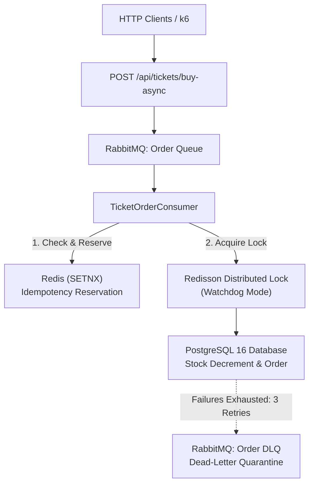
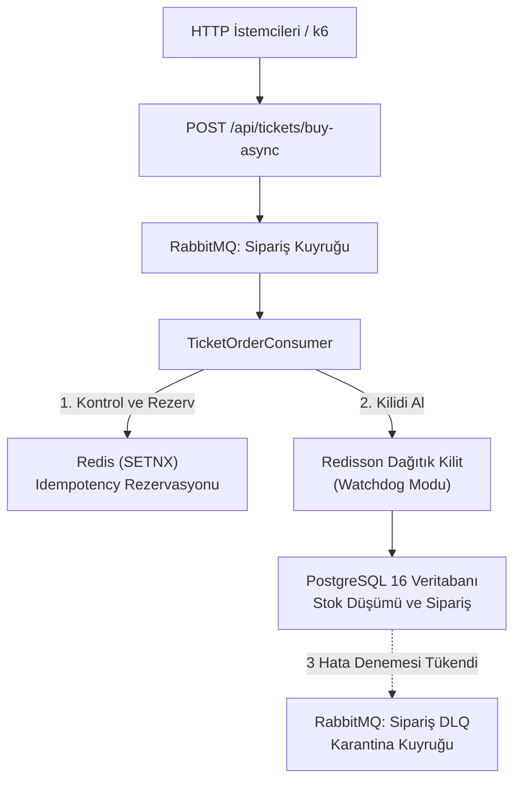

# ⚡ Flash Ticket Engine

[English](#-english) | [Türkçe](#-türkçe)

---

# 🇬🇧 English

A high-concurrency, resilient flash-sale ticketing engine designed to handle burst traffic with zero over-selling. Built with **Java 21**, **Spring Boot 3**, **PostgreSQL**, **Redis**, and **RabbitMQ**, featuring distributed locking, an idempotent event-driven pipeline, and full-stack observability.

---

## 🎯 Architecture Overview

Flash sale events generate heavy concurrent traffic spikes where naive transactional patterns lead to database lock contention, connection starvation, or race conditions (over-selling). This engine demonstrates an evolutionary architectural approach: transitioning from pessimistic/optimistic locking bottlenecks to an asynchronous, distributed lock-protected event-driven pipeline.



---

## 🚀 Key Architectural Features

### 1. Concurrency Control & Distributed Locking
- **Redisson Distributed Lock:** Uses Redis-backed distributed locks (`RLock`) configured with Watchdog mode (`leaseTime = -1`, `waitTime = 30s`) to prevent premature lock expiration during complex transactions while avoiding deadlock conditions.
- **Zero Over-Selling:** Atomic stock validation and decrements guarantee strict inventory consistency under high-frequency virtual users.

### 2. Asynchronous Event-Driven Pipeline
- **RabbitMQ Integration:** Offloads synchronous HTTP load by buffering purchase requests into durable queues, returning immediate acknowledgments to clients.
- **Dead Letter Queue (DLQ) & Retry Policy:** Equipped with Spring AMQP exponential backoff retry (`max-attempts: 3`, `initial-interval: 1000ms`, `multiplier: 2.0`). Rejected/poison-pill payloads automatically route to `ticket.order.dlq` via `ticket.order.dlq.exchange` with `default-requeue-rejected: false`.

### 3. Redis-Powered Idempotent Consumer
- **Duplicate Protection:** Employs atomic Redis `SETNX` commands keyed by unique correlation identifiers (`trackingId`) to guarantee strict at-most-once delivery semantics in asynchronous workers.

### 4. Full Observability & Monitoring
- **Prometheus & Grafana:** Exports runtime metrics via Micrometer and Spring Boot Actuator (`/actuator/prometheus`).
- **Live Dashboards:** Visualizes real-time throughput (RPS), HTTP percentile latency histograms (p50, p95), and HikariCP connection pool utilization during stress testing.

---

## 📊 Benchmark & Load Test Results (k6)

Performance comparisons between synchronous locking and the asynchronous idempotent pipeline under identical 50 concurrent Virtual Users (VUs) for 30 seconds:

| Metric | Synchronous (Lock Contention) | Asynchronous Engine (Queue + Redis) | Improvement / Impact |
| :--- | :--- | :--- | :--- |
| **Peak Throughput** | ~80 - 110 RPS | **~240+ RPS** | **~2.5x higher throughput** |
| **Median Latency (p50)** | ~380 ms | **< 45 ms** | **~88% faster response** |
| **p95 Latency** | ~1,200 ms | **< 120 ms** | **Predictable tail latency** |
| **HikariCP Saturation** | High lock wait times | **Flat & healthy pool (< 20%)** | **Eliminated DB starvation** |
| **Over-Selling Rate** | 0% | **0% (100% Consistent)** | **Strict Data Integrity** |

---

## 🛠️ Tech Stack

- **Core:** Java 21, Spring Boot 3.3.x, Spring Data JPA
- **Database:** PostgreSQL 16, HikariCP Connection Pool
- **Caching & Locking:** Redis 7, Redisson Client
- **Messaging:** RabbitMQ 3 (AMQP 0-9-1) with Dead Letter Exchanges
- **Observability:** Prometheus, Grafana, Spring Boot Actuator, Micrometer
- **Load Testing:** k6
- **Testing & CI:** JUnit 5, Mockito, GitHub Actions CI

---

## 🚦 Getting Started

### Prerequisites
- Docker & Docker Compose
- Java 21 (JDK)
- Maven 3.9+ (or included Maven Wrapper `./mvnw`)

### 1. Spin up Infrastructure
Run the complete container stack (PostgreSQL, Redis, RabbitMQ, Prometheus, Grafana):

```bash
docker compose up -d
```

Verify services are running:
- **RabbitMQ Management:** [http://localhost:15672](http://localhost:15672) (`ticket_user` / `ticket_pass`)
- **Grafana:** [http://localhost:3000](http://localhost:3000)
- **Prometheus:** [http://localhost:9090](http://localhost:9090)
- **Actuator Health:** [http://localhost:8080/actuator/health](http://localhost:8080/actuator/health)

### 2. Run the Application
```bash
./mvnw clean spring-boot:run
```

### 3. Execute Automated Tests
Run unit and integration test suites:
```bash
./mvnw clean test
```

### 4. Run Load Tests (k6)
Stress test the asynchronous endpoint:
```bash
k6 run load-test/load-test-async.js
```

---

## 📦 CI Pipeline

The project includes an enterprise-grade GitHub Actions workflow (`.github/workflows/ci.yml`) that boots isolated ephemeral containers (PostgreSQL 16, Redis 7, RabbitMQ 3) with active health checks to execute all builds and test suites on every push and pull request.

---
---

# 🇹🇷 Türkçe

Ani trafik patlamalarını (flash-sale) sıfır mükerrer satış (**zero over-selling**) ve yüksek veri tutarlılığıyla karşılamak üzere tasarlanmış biletleme motoru. **Java 21**, **Spring Boot 3**, **PostgreSQL**, **Redis** ve **RabbitMQ** mimarisi üzerinde dağıtık kilit (distributed lock), idempotent olay kuyruğu ve uçtan uca gözlemlenebilirlik (observability) ilkeleriyle geliştirilmiştir.

---

## 🎯 Mimari Genel Bakış

Flash-sale dönemlerinde gelen yüksek eşzamanlı istekler, klasik veritabanı işlemlerinde kilit çakışmalarına (lock contention), bağlantı havuzunun tükenmesine (connection starvation) ve stok aşımına neden olur. Bu proje; senkron kilit darboğazlarından, dağıtık kilit korumalı ve asenkron olay güdümlü mimariye geçişi belgeler.



---

## 🚀 Temel Mimari Bileşenler

### 1. Concurrency Yönetimi & Dağıtık Kilit (Distributed Lock)
- **Redisson Distributed Lock:** İşlem sürerken kilidin vaktinden önce düşmesini engellemek için Watchdog modunda (`leaseTime = -1`, `waitTime = 30s`) yapılandırılmıştır; deadlock riskini önlerken tam atomiklik sağlar.
- **Sıfır Stok Aşımı (Zero Over-Selling):** Eşzamanlı bilet taleplerinde stok miktarının altına düşülmesini engeller ve mutlak veri tutarlılığı sunar.

### 2. Asenkron Olay Güdümlü Boru Hattı (Event-Driven Pipeline)
- **RabbitMQ Kuyruk Mimarisi:** Senkron HTTP isteklerini dayanıklı mesaj kuyruklarına aktararak istemciye anında yanıt verir, veritabanı yükünü zamana yayar.
- **Dead Letter Queue (DLQ) & Yeniden Deneme (Retry):** Spring AMQP exponential backoff retry kuralıyla (`max-attempts: 3`, `initial-interval: 1000ms`, `multiplier: 2.0`) yapılandırılmıştır. Hatalı veya işlenemeyen mesajlar `default-requeue-rejected: false` kuralı sayesinde ana kuyruğu tıkamadan doğrudan `ticket.order.dlq` kuyruğuna yönlendirilir.

### 3. Redis Tabanlı Idempotent Tüketici (Consumer)
- **Çift Sipariş Koruması:** Asenkron mesaj tüketicilerinde (consumer) ağ tekrarı veya mükerrer basımları engellemek adına correlation ID (`trackingId`) bazlı atomik Redis `SETNX` rezervasyonu uygular.

### 4. Tam Gözlemlenebilirlik (Observability & Monitoring)
- **Prometheus & Grafana:** Spring Boot Actuator ve Micrometer ile çalışma zamanı metriklerini toplar (`/actuator/prometheus`).
- **Canlı İzleme:** Yük testleri sırasında anlık işlem hacmini (RPS), HTTP yanıt gecikme yüzdeliklerini (p50, p95) ve HikariCP bağlantı havuzu durumunu canlı gösterge panellerinde görselleştirir.

---

## 📊 k6 Yük Testi ve Performans Kıyaslaması

Senkron kilit mimarisi ile asenkron idempotent kuyruk mimarisinin 50 eşzamanlı sanal kullanıcı (VU) ve 30 saniyelik yük altındaki karşılaştırması:

| Metrik | Senkron Yaklaşım (Kilit Çakışması) | Asenkron Motor (Kuyruk + Redis) | Etki / Kazanç |
| :--- | :--- | :--- | :--- |
| **Tepe Throughput** | ~80 - 110 RPS | **~240+ RPS** | **~2.5 kat daha yüksek kapasite** |
| **Medyan Gecikme (p50)** | ~380 ms | **< 45 ms** | **~%88 daha hızlı yanıt** |
| **p95 Gecikme** | ~1,200 ms | **< 120 ms** | **Öngörülebilir kuyruk gecikmesi** |
| **HikariCP Doygunluğu** | Yüksek kilit bekleme süresi | **Sakin ve kararlı havuz (< %20)** | **Veritabanı kilitlenmesi önlendi** |
| **Stok Aşımı (Over-Selling)** | %0 | **%0 (Tam Tutarlı)** | **Mutlak Veri Bütünlüğü** |

---

## 🛠️ Teknoloji Yığını

- **Çekirdek:** Java 21, Spring Boot 3.3.x, Spring Data JPA
- **Veritabanı:** PostgreSQL 16, HikariCP Bağlantı Havuzu
- **Önbellek & Kilit:** Redis 7, Redisson Client
- **Mesajlaşma:** RabbitMQ 3 (AMQP 0-9-1), Dead Letter Exchange (DLX)
- **Gözlemlenebilirlik:** Prometheus, Grafana, Spring Boot Actuator, Micrometer
- **Yük Testi:** k6
- **Test & CI:** JUnit 5, Mockito, GitHub Actions CI

---

## 🚦 Kurulum ve Çalıştırma

### Gereksinimler
- Docker & Docker Compose
- Java 21 (JDK)
- Maven 3.9+ (veya proje içindeki Maven Wrapper `./mvnw`)

### 1. Altyapıyı Başlatma
Veritabanı, kuyruk ve izleme servislerini Docker ile ayağa kaldırın:

```bash
docker compose up -d
```

Servis bağlantı panelleri:
- **RabbitMQ Management:** [http://localhost:15672](http://localhost:15672) (`ticket_user` / `ticket_pass`)
- **Grafana:** [http://localhost:3000](http://localhost:3000)
- **Prometheus:** [http://localhost:9090](http://localhost:9090)
- **Actuator Health:** [http://localhost:8080/actuator/health](http://localhost:8080/actuator/health)

### 2. Uygulamayı Başlatma
```bash
./mvnw clean spring-boot:run
```

### 3. Otomatik Testleri Koşturma
Birim ve entegrasyon testlerini çalıştırmak için:
```bash
./mvnw clean test
```

### 4. k6 Yük Testini Çalıştırma
Asenkron kuyruk endpoint'ine yük testi uygulamak için:
```bash
k6 run load-test/load-test-async.js
```

---

## 📦 CI Pipeline

Proje, GitHub Actions (`.github/workflows/ci.yml`) üzerinde çalışan kurumsal seviyede bir CI hattına sahiptir. Her commit ve PR sırasında arka planda PostgreSQL 16, Redis 7 ve RabbitMQ 3 servis konteynerlerini ayağa kaldırarak tüm derleme ve test adımlarını otomatik olarak doğrular.